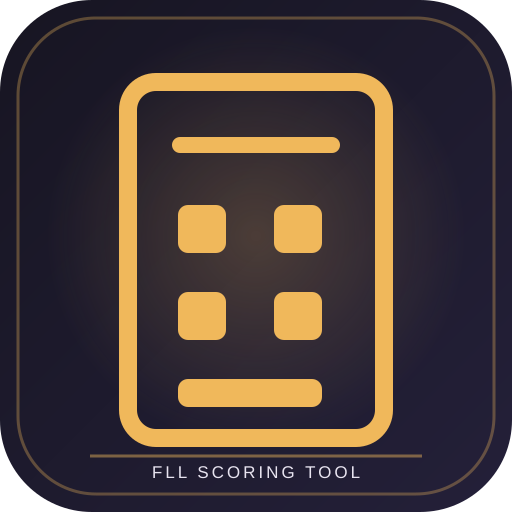

**FLL SCORING TOOL**

---

# Rabbitech BIOGLOW Future Edition Score

**An independent scoring calculator developed for the FIRST LEGO League Future Edition competition mat.**

I built this calculator as a competing participant to translate the new mat's missions and scoring rules into a practical digital scoring tool. To my knowledge, it was the **first calculator created by a competitor anywhere in the world specifically for the Future Edition mat**.

This is an independent community project, not an official FIRST or LEGO product. Always verify mission values and scoring conditions against the official challenge materials for the current season.

## Features

- **Mission scoring:** enter quantities and yes/no mission results through guided controls.
- **Live total:** recalculate the match score as values change.
- **Penalty handling:** apply interference penalties, including the zero-score rule for the third penalty.
- **Team management:** create teams, store an optional team number, and switch between teams.
- **Match records:** save a named practice or official match, optional opponent, date, total, penalties, and mission breakdown.
- **History:** review saved matches and inspect the score details.
- **Comparisons:** compare each team's average and best score, including average points per mission.
- **Data portability:** export all teams and matches to JSON and import a JSON backup on another browser or device.

## How data is stored

This is a standalone browser application. Team and match data are stored in the browser's **localStorage** on the current device.

That means:
- Data is not automatically synchronized to a server or another device.
- Clearing browser storage can remove locally saved scores.
- Use the Export scores control regularly to keep a backup.
- Use the Import scores control to merge a valid JSON backup into the current browser.

## Run the app

The project uses plain HTML, CSS, and JavaScript. No package installation or build step is required.

You can open index.html directly in a modern browser or publish the three application files to a static web host:

- index.html
- style.css
- script.js

Live version: https://rabbitech-calculator.vercel.app

## Scoring integrity

The mission model includes mission names, scoring values, conditions, and penalties. Always compare the calculator's rules with the current official FIRST LEGO League challenge materials before an event. This is an independent team tool and is **not an official FIRST or LEGO application**.

## Technology

- HTML5
- CSS3
- Vanilla JavaScript
- Browser localStorage
- JSON import/export

## Project status

A season-specific scoring tool for the Future Edition mat. Keep its mission model aligned with the official challenge materials and document every rule update.
